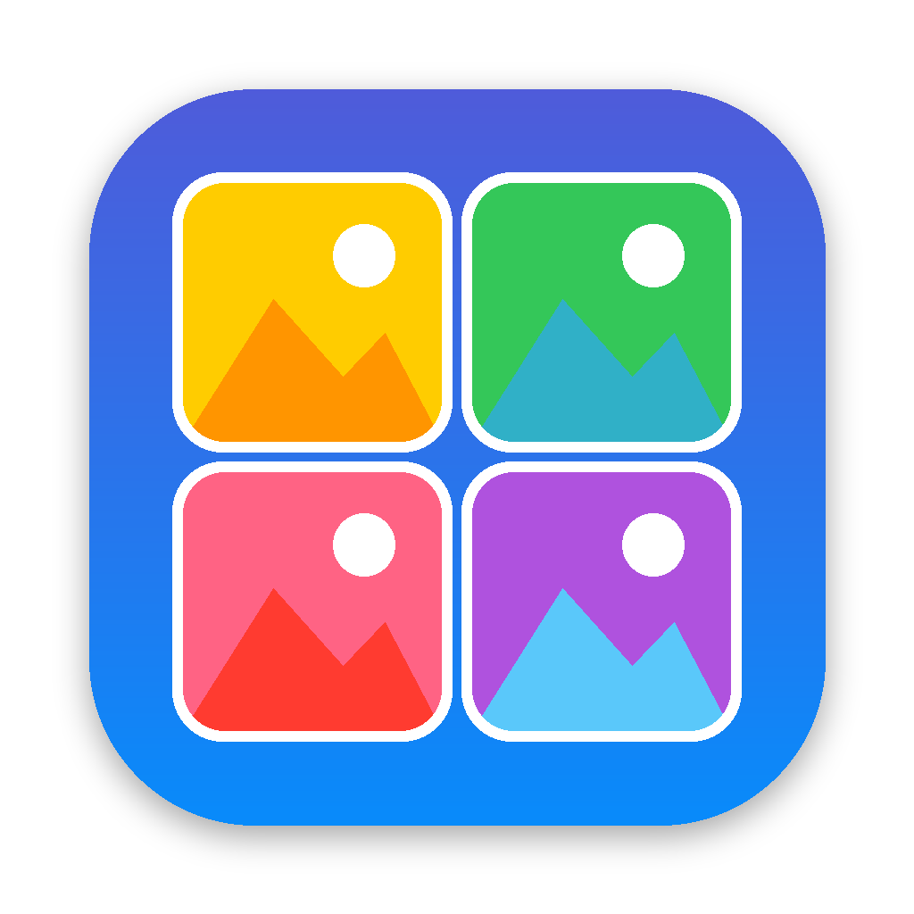

# スクショギャラリー（Mac アプリ）



Mac のスクリーンショットを、スマホの写真アプリのように一覧・拡大表示するアプリです。
開くだけで、スクリーンショットの保存先フォルダを自動で見つけて表示します。新しく撮ったスクショもすぐ一覧に追加されます。

## インストール

**ターミナル**（Launchpad の「その他」の中、または ⌘ + スペースで「ターミナル」と入力）を開いて、次の1行を貼り付けて Enter を押します。

```
curl -fsSL https://raw.githubusercontent.com/rakusa053/cloud_experiment/claude/current-configuration-hkmgga/mac-app/install.sh | bash
```

「アプリケーション」フォルダに **スクショギャラリー** が入り、自動で起動します。
初回に「デスクトップフォルダ内のファイルへのアクセス」を求められたら **許可** してください。

Dock に置いておくには、起動中に Dock のアイコンを右クリックして「オプション › Dock に追加」を選びます。

アップデートするときも同じコマンドを実行します。

## 使い方

| 操作 | 方法 |
|---|---|
| 大きく表示 | サムネイルをクリック |
| 前後の画像 | ← → キー / トラックパッドで2本指スワイプ / 左右の矢印 |
| 拡大・縮小 | ダブルクリック / ピンチ / スペースキー |
| 一覧に戻る | esc |
| コピー | ⌘C（チャットなどにそのまま貼り付け可能） |
| ゴミ箱に入れる | ⌘⌫ |
| サムネイルの大きさ | ツールバーのスライダー |
| 別のフォルダを表示 | ツールバーの「フォルダを変更」（⌘O） |

サムネイルを右クリックすると、コピー・プレビューで開く・Finderで表示・ゴミ箱に入れる、が選べます。

## アンインストール

「アプリケーション」フォルダの **スクショギャラリー** をゴミ箱に入れます。

## 開発者向け

- ソース: `Sources/ScreenshotGallery.swift`（SwiftUI、macOS 13 以降）
- ビルド: `./build.sh`（Xcode Command Line Tools が必要）
- `mac-app/` への push で GitHub Actions がビルドし、Release `mac-app-latest` に `ScreenshotGallery.zip` を公開します。
